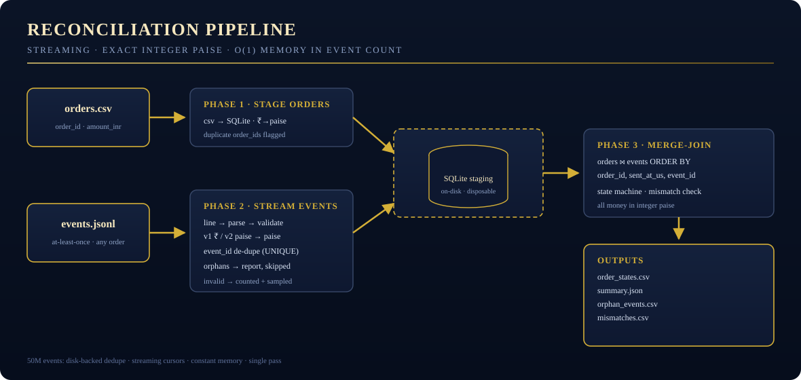

<p align="center">
  
</p>

<h1 align="center">Payment Reconciliation Service</h1>

<p align="center">
  <em>Orders in. Webhooks in. Truth out — to the paisa, at any scale.</em><br/>
  <sub>Gharana Home Co. · Arcass Automation · Round 2 assignment · April–June 2026 settlement cycle</sub>
</p>

<p align="center">
  
  
  
  
  
</p>

---

## What this is

Gharana Home Co. takes payments through a gateway. The gateway notifies Gharana by
webhook for every event. **Finance found that the order database and the gateway's
settlement don't agree.** This service replays three months of webhooks against the
orders table and reports the true final state of every order — and exactly how much
money should settle, to the paisa.

It is built to survive the real thing: 50 million events, at-least-once delivery,
out-of-order arrivals, two API versions, one cut-off instant, and an auditor reading
the code afterwards.

```
orders.csv ─┐
            ├─► validate → de-dupe (event_id) → orphan quarantine → merge-join in sent_at order
events.jsonl┘        (streaming, SQLite-staged)                │
                                                               ▼
                            order_states.csv · summary.json · orphan_events.csv · mismatches.csv
```

<p align="center">
  
</p>

---

## Requirements coverage — the audit trail

Every requirement in the Round 2 brief and where it lives in this repository:

| # | Brief requirement | Where it is handled |
|---|-------------------|---------------------|
| 1 | Reconcile `events.jsonl` × `orders.csv` | `src/payment_reconciliation/engine.py` (merge-join + state machine) |
| 1 | Duplicate webhook detection | `store.py` — `UNIQUE(event_id)` insert; `summary.json → duplicate_deliveries_ignored` |
| 1 | Out-of-order events | applied in `(sent_at, event_id)` order, never arrival order — `engine.py` phase 3 |
| 1 | Idempotency | `event_id` is the idempotency key everywhere (batch, tests, and the live-service design) |
| 1 | Refunds | `refund.created` = pending (no money); `refund.processed` moves money; `PARTIALLY_REFUNDED`/`REFUNDED` on `≥ captured` |
| 1 | Authorization expiry | `AUTHORIZED` vs `EXPIRED` at cut-off − 7 days (`timeutil.py`, `engine.py:finalize_order`) |
| 1 | Orphan events | quarantined to `orphan_events.csv`, counted, **never processed** |
| 1 | API v1/v2 amount conversion | `money.py` — v1 ₹ decimal via `Decimal` → paise; v2 whole paise |
| 1 | IST timezone handling | everything normalized to Asia/Kolkata; cut-off `2026-06-30T23:59:59+05:30`; naive ⇒ IST (documented) |
| 1 | Mismatch detection | capture ≠ order amount ⇒ `mismatch=true`, state kept; `mismatches.csv` export |
| 1 | Exact INR calculations | **integer paise end-to-end; zero floats touch money** |
| 1 | `order_states.csv` | `outputs/order_states.csv` — one row per order in `orders.csv` |
| 1 | `summary.json` | counts per state, unique events, duplicates ignored, orphans, mismatches, captured, refunded, fees, **net settlement** |
| 1 | Streaming / 50M events | SQLite-staged merge-join, streaming cursors; ~20 MB RSS measured on 520k events — flat in event count |
| 2 | Automated tests, one command | `make test` (pytest) — **96 tests**, incl. all 8 brief scenarios |
| 3 | Junior handler code review | `docs/code-review.md` — 21 findings ranked P0→P3 + corrected implementation |
| 4 | ≤2-page production design note | `docs/production-design-note.md` — 2,000 events/sec, concurrency, schema, retries, API v3, Finance alerting |
| 5 | Finance findings note | `make findings` → `docs/findings.md` — generated **from your data only** |
| — | `answers.csv` | yours; `python -m payment_reconciliation digest` prints every figure you need to fill it |
| — | GitHub-ready upload | this repo + `.gitignore` that keeps your confidential data out of the public push |

---

## Quickstart

### 1 · Install

```bash
python3 -m venv .venv && source .venv/bin/activate     # optional but tidy
pip install -e ".[dev]"                                # or: make setup
```

### Windows / PowerShell (no `make`?)

Everything `make` does is a thin wrapper around direct Python commands — copy-paste these:

```powershell
pip install -e ".[dev]"
python -m pytest                                             # tests
python -m payment_reconciliation reconcile --orders data\orders.csv --events data\events.jsonl --out outputs
python -m payment_reconciliation digest                      # headline figures for answers.csv
python scripts\generate_findings.py --summary outputs\summary.json --states outputs\order_states.csv --out docs\findings.md
```

Or use the included PowerShell targets (same words as the Makefile):

```powershell
.\make.ps1 test
.\make.ps1 reconcile
.\make.ps1 findings
```

### 2 · Drop in your three files

```
data/orders.csv      ← yours (order_id,customer_id,created_at,amount_inr)
data/events.jsonl    ← yours (one webhook JSON per line)
data/answers.csv     ← yours (the assignment answer sheet)
```

They are deliberately **not** in this repo and **not** committed (see `.gitignore`):
your data is unique and confidential. See `data/README.md` for the exact schema.

### 3 · Run the reconciliation

```bash
python -m payment_reconciliation reconcile \
  --orders data/orders.csv --events data/events.jsonl --out outputs
# equivalently: make reconcile
```

Outputs land in `outputs/`:

| File | Contents |
|------|----------|
| `order_states.csv` | `order_id, final_state, captured_inr, refunded_inr, mismatch` — every order, one row |
| `summary.json` | totals, per-state counts, duplicates/orphans/invalids, fees, **net settlement (₹, paise-exact)** |
| `orphan_events.csv` | webhook events for orders missing from `orders.csv` — reported, never processed |
| `mismatches.csv` | orders whose captured total ≠ billed amount, with the paise difference |

### 4 · Run the tests

```bash
make test        # one command → pytest (96 tests)
```

### 5 · Generate the Finance findings report

```bash
make findings    # reads outputs/, writes docs/findings.md with YOUR numbers
```

### 6 · Fill `answers.csv`

```bash
python -m payment_reconciliation digest    # prints every headline figure from outputs/summary.json
```

---

## How it works (the 60-second version)

1. **Phase 1 — stage orders.** `orders.csv` streams into a disposable on-disk SQLite table
   (`₹ → paise` via `Decimal`). Duplicate `order_id`s are counted, first row wins.
2. **Phase 2 — stream events.** Each JSONL line is parsed, validated (type allow-list,
   `api_version`, amount, `sent_at`), deduplicated by `event_id` inside one transaction, and
   routed: unknown order → `orphan_events`; otherwise staged. Malformed lines are counted and
   sampled into the summary — never silently dropped.
3. **Phase 3 — merge-join.** Orders and events are both consumed in `order_id` order (events
   also ordered by `sent_at, event_id`) with streaming cursors — constant memory. A per-order
   state machine applies events and emits one row to `order_states.csv`. Fees accumulate integer-paise.

**Why this scales to 50M:** nothing is held in RAM proportional to the input; the expensive
uniqueness check is a B-tree insert on disk; the final pass is a linear merge. Measured on a
synthetic 520k-event file: ~11 s wall, **~20 MB peak RSS**. For 50M, expect O(20 min) single-process
(dominated by JSON parsing and dedupe I/O); shard by `order_id` if you ever need it faster —
pure functions, no shared state.

**State machine (per order):**

```
              failed only                authorized (≤7d before cut-off)      captured, no refunds
   ┌───────┐ ────────────►  FAILED     ─────────────►  AUTHORIZED  ──────────────►  CAPTURED
   │ order │                                   │            │  >7d old                 │
   │ row   │                                   ▼            ▼                          ▼
   └───────┘                               (any)        EXPIRED                refunds < captured → PARTIALLY_REFUNDED
                                                                                 refunds ≥ captured → REFUNDED
```

Failures after a capture are stale and ignored; a later authorization or capture overrides an
earlier failure; `refund.created` never moves money. Details & edge cases: `docs/assumptions.md`.

---

## Repository layout

```
.
├── README.md                       ← you are here
├── Makefile                        ← setup · test · reconcile · findings · zip
├── pyproject.toml                  ← src-layout package, pytest config, zero runtime deps
├── requirements-dev.txt
├── data/                           ← YOUR 3 datasets go here (git-ignored)
├── outputs/                        ← generated: order_states.csv, summary.json, …
├── src/payment_reconciliation/
│   ├── cli.py                      ← `reconcile` + `digest` subcommands
│   ├── engine.py                   ← 3-phase pipeline + state machine + summary
│   ├── store.py                    ← SQLite staging (dedupe, orphans, merge cursors)
│   ├── parsers.py                  ← streaming CSV/JSONL readers + validators
│   ├── money.py                    ← integer-paise arithmetic, fee rounding (half-up)
│   ├── timeutil.py                 ← IST handling, cut-off, expiry math
│   └── models.py                   ← event/order-accumulator types
├── tests/                          ← 96 tests: money, tz, parsers, engine scenarios, end-to-end
├── docs/
│   ├── code-review.md              ← junior handler: 21 findings P0→P3 + corrected code
│   ├── production-design-note.md   ← 2,000 events/sec live service (≤2 pages)
│   ├── assumptions.md              ← every judgment call, written down
│   ├── findings.template.md        ← what `make findings` fills in from your data
│   └── findings.md                 ← generated Finance report (git-ignored)
├── scripts/generate_findings.py    ← findings generator — numbers from your files only
└── assets/                         ← logo & pipeline diagram (navy/gold identity)
```

## Development standards honoured

- **Integer paise** (`int`) for every amount; `Decimal` only at parse time; **no `float` near money**.
- **Streaming** everywhere; O(1)-memory merge-join; no `list(events)` anywhere in the pipeline.
- **Zero runtime dependencies**; pytest is the only dev dependency.
- Pure, typed, single-responsibility modules; comprehension-friendly but not clever.
- Tests double as executable documentation of the assignment's rules.

## Limitations (honest ones)

- `.reconcile_work.sqlite` is a scratch file on disk; keep the output dir on a real filesystem.
- Fee rounding is round-half-up (stated, tested); the gateway's internal rounding mode is undocumented.
- Out-of-the-box correctness is against the brief's contract; if the gateway emits other `type`s they are
  counted as `invalid_events` and sampled into the summary, not crashed on.

## Submission checklist

- [ ] `data/` contains your three files (never commit them)
- [ ] `make reconcile` → `outputs/order_states.csv` + `outputs/summary.json` (+ `orphan_events.csv`, `mismatches.csv`)
- [ ] `make test` → 96 passing
- [ ] `make findings` → `docs/findings.md` (review it, it goes to Finance unedited)
- [ ] Fill `answers.csv` (use `python -m payment_reconciliation digest`)
- [ ] Push **code** to your public GitHub repo (verify `git status` shows no `data/` files)
- [ ] Email per the brief: source link, outputs, code review + design note + findings, `answers.csv`

## Troubleshooting

| Symptom | Fix |
|---|---|
| `pandas`-style `UnicodeDecodeError` on events | file is read as UTF-8 with replacement; check for corrupt lines — they will be counted as `invalid_events` |
| `orders.csv is missing required columns` | headers must include `order_id` and `amount_inr` (case-insensitive not applied; match exactly) |
| Everything EXPIRED | confirm `--cutoff` (defaults to 2026-06-30 IST); authorizations older than cut-off − 7d are EXPIRED by rule |
| Slow on huge files | put `outputs/` on local disk; `--keep-work-db` lets you inspect the staging DB; shard by order_id if needed |

## License

MIT — see `LICENSE`. Your data remains yours; this license covers code only.
